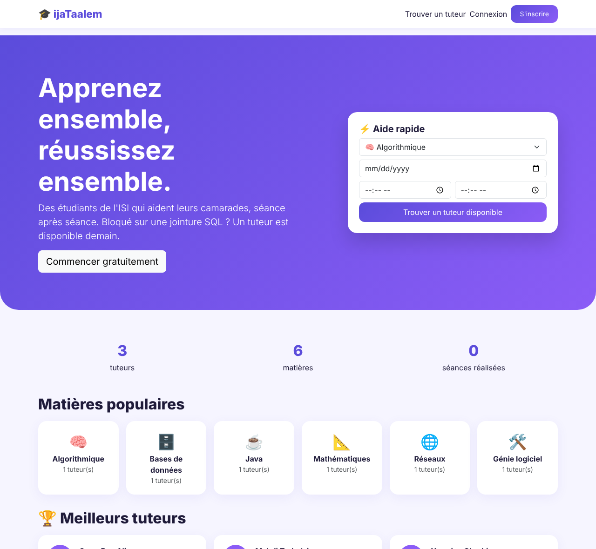
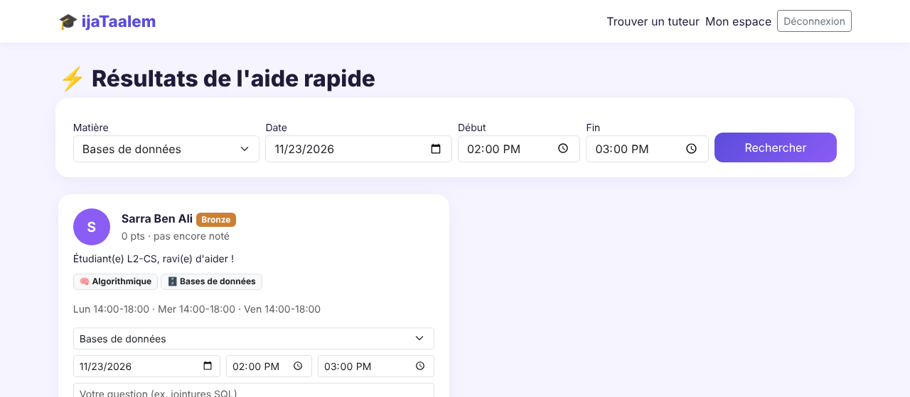
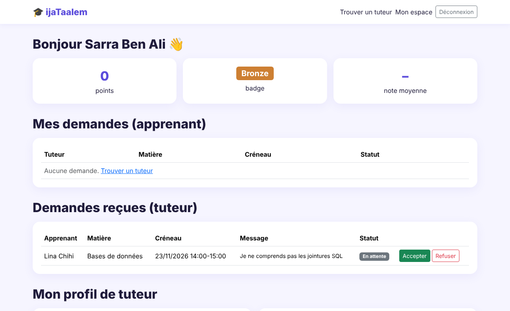
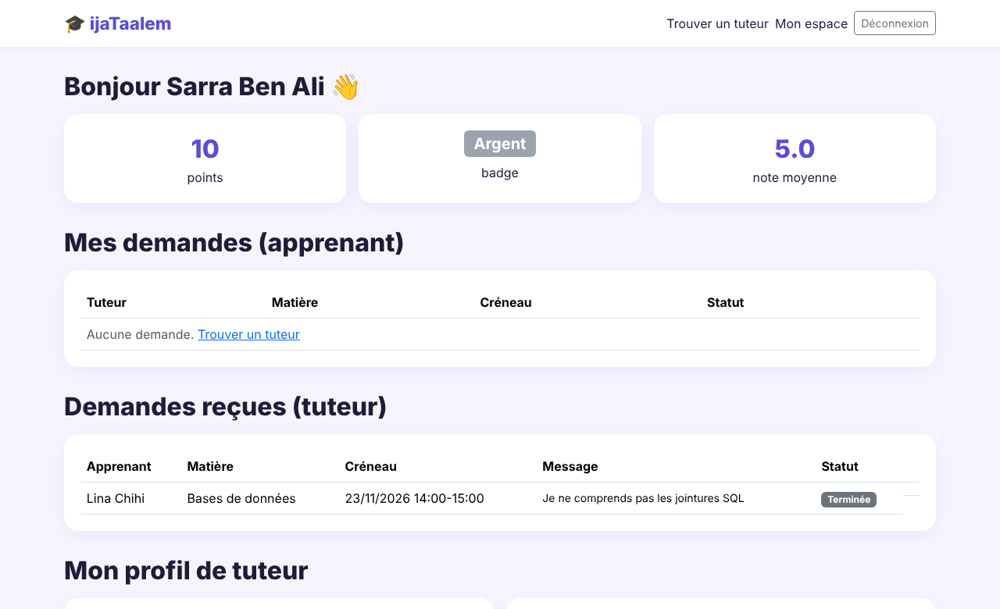

# ijaTaalem

Plateforme web d'entraide entre étudiants : un apprenant trouve un tuteur disponible sur son créneau, demande une séance, puis note l'aide reçue. Les tuteurs cumulent des points et des badges.


Projet réalisé par **Lina Chihi** (L2-CS, ISI, Université Tunis El Manar, 2026/2027) dans le cadre de la matière *Outils de travail collaboratif (Génie logiciel et données)*, encadrée par Dr. Zakia Zouaghia. Le cahier des charges et le dossier de conception sont fournis à part (`cahier_des_charges.tex`).

## Sommaire

1. [Fonctionnalités](#fonctionnalités)
2. [Aperçu](#aperçu)
3. [Pile technique](#pile-technique)
4. [Prérequis](#prérequis)
5. [Installation](#installation)
6. [Configuration](#configuration)
7. [Utilisation](#utilisation)
8. [Tests](#tests)
9. [Architecture](#architecture)
10. [Règles de gestion](#règles-de-gestion)
11. [Déploiement](#déploiement)
12. [Limites connues](#limites-connues)
13. [Feuille de route](#feuille-de-route)

## Fonctionnalités

| Rôle | Fonctionnalités |
|---|---|
| Visiteur | Consulter l'accueil, rechercher des tuteurs, utiliser l'aide rapide, s'inscrire, se connecter |
| Apprenant | Demander une séance, suivre et annuler ses demandes, noter un tuteur |
| Tuteur | Déclarer ses matières, gérer ses disponibilités hebdomadaires, accepter ou refuser une demande, terminer une séance, consulter ses points et son badge |
| Administrateur | Gérer les matières, supprimer un compte |

Un même compte est à la fois apprenant et tuteur dès qu'une matière est cochée dans son profil.

## Aperçu

| Accueil et aide rapide | Résultats de l'aide rapide |
|---|---|
|  |  |

| Espace du tuteur | Progression (points, badge) |
|---|---|
|  |  |

## Pile technique

| Composant | Technologie |
|---|---|
| Langage | Python 3.10+ |
| Framework web | Flask 3 |
| Base de données | SQLite, accès par Flask-SQLAlchemy |
| Vues | Jinja2, HTML, Bootstrap 5 (servi localement) |
| Tests | pytest |
| Gestion de versions | Git, GitHub |
| Hébergement visé | PythonAnywhere |

## Prérequis

- Python 3.10 ou plus (`python --version`)
- Git
- Un terminal (Visual Studio Code recommandé)

## Installation

```bash
git clone https://github.com/<utilisateur>/ijaTaalem.git
cd ijaTaalem
python -m venv venv
source venv/bin/activate        # Windows : venv\Scripts\activate
pip install -r requirements.txt
```

Initialiser des données de démonstration (développement uniquement) :

```bash
flask --app app seed
```

Lancer l'application :

```bash
flask --app app run --debug
```

L'application répond sur <http://127.0.0.1:5000>.

## Configuration

| Variable | Rôle | Valeur par défaut |
|---|---|---|
| `SECRET_KEY` | Clé de signature des sessions. **À définir en production.** | Valeur de développement |
| `DATABASE_URL` | URL de la base SQLAlchemy | `sqlite:///ijataalem.db` (dossier `instance/`) |

Générer une clé secrète :

```bash
python -c "import secrets; print(secrets.token_hex(32))"
```

Ne jamais enregistrer une clé secrète dans le dépôt. Le fichier `.env` est ignoré par Git.

## Utilisation

Comptes créés par `flask --app app seed` (développement) :

| Rôle | E-mail | Mot de passe |
|---|---|---|
| Administrateur | `admin@isi.tn` | `admin123` |
| Tuteurs | `tuteur1@isi.tn`, `tuteur2@isi.tn`, `tuteur3@isi.tn` | `motdepasse` |

**Ces comptes sont publics : ne pas exécuter `seed` en production.** Pour créer un administrateur sans données de démonstration :

```bash
flask --app app create-admin --email admin@exemple.tn
```

La commande demande le mot de passe (8 caractères minimum) et le confirme.

## Tests

```bash
pytest -v
```

La suite compte 26 tests exécutés sur une base SQLite en mémoire :

- `tests/test_regles.py` : règles de gestion RG-01 à RG-06 et RG-09, valeurs limites des badges et des créneaux ;
- `tests/test_routes.py` : authentification, contrôle d'accès, validation des formulaires, unicité de l'e-mail (RG-07), suppression des matières (RG-08), commande `create-admin`.

## Architecture

Architecture MVC : `models.py` (modèle et règles de gestion), `templates/` (vues), `app.py` (contrôleur).

```text
ijaTaalem/
├── app.py                 routes, create_app, commandes seed et create-admin
├── models.py              modèles SQLAlchemy et règles de gestion
├── requirements.txt       dépendances
├── deploy_github.sh       envoi du projet vers GitHub
├── templates/             base, index, auth, tuteurs, dashboard, admin
├── static/                bootstrap.min.css, style.css
├── tests/                 conftest.py, test_regles.py, test_routes.py
└── docs/screenshots/      captures utilisées par ce README
```

Modèle de données : `user`, `matiere`, `tuteur_matiere`, `disponibilite`, `seance`, `avis`.

## Règles de gestion

| ID | Règle |
|---|---|
| RG-01 | Un tuteur n'accepte pas deux séances qui se chevauchent le même jour |
| RG-02 | Pas de demande de séance à soi-même |
| RG-03 | Une séance se note une fois, après sa fin, avec une note de 1 à 5 |
| RG-04 | Points : 5 par séance terminée plus la note ; badges Bronze (0-9), Argent (10-29), Or (30+) |
| RG-05 | Demande : matière enseignée par le tuteur, date non passée, fin après début |
| RG-06 | Seul le tuteur accepte, refuse ou termine ; seul l'apprenant annule |
| RG-07 | Une adresse e-mail par compte |
| RG-08 | Une matière utilisée par une séance ne peut pas être supprimée |
| RG-09 | L'aide rapide ne propose que des tuteurs disponibles et libres sur le créneau |

## Déploiement

### Envoi vers GitHub

Créer un dépôt vide `ijaTaalem` sur GitHub, puis :

```bash
git init
git add .
git commit -m "Version initiale de ijaTaalem"
git branch -M main
git remote add origin https://github.com/<utilisateur>/ijaTaalem.git
git push -u origin main
```

Le script `deploy_github.sh <URL du dépôt>` enchaîne ces commandes. Marquer une version livrée :

```bash
git tag -a v1.0.0 -m "Version 1.0.0"
git push origin v1.0.0
```

### Mise en ligne sur PythonAnywhere

1. Dans une console Bash du compte :

   ```bash
   git clone https://github.com/<utilisateur>/ijaTaalem.git
   cd ijaTaalem
   python3 -m venv venv && source venv/bin/activate
   pip install -r requirements.txt
   flask --app app create-admin --email admin@exemple.tn
   ```

2. Onglet **Web** : *Add a new web app*, *Manual configuration*, choisir la version de Python, renseigner le dossier du code et celui du virtualenv.
3. Fichier WSGI :

   ```python
   import os, sys
   sys.path.insert(0, '/home/<utilisateur>/ijaTaalem')
   os.environ['SECRET_KEY'] = '<clé générée>'
   from app import create_app
   application = create_app()
   ```

4. Cliquer sur **Reload**, puis vérifier : accueil, inscription, connexion, aide rapide, accès refusé à `/admin` pour un compte étudiant.

### Mise à jour, sauvegarde et retour arrière

```bash
git pull
cp instance/ijataalem.db ~/sauvegardes/ijataalem-$(date +%Y%m%d).db   # avant toute mise à jour
```

Puis **Reload**. En cas de problème : `git checkout v1.0.0`, restauration de la sauvegarde si le schéma a changé, **Reload**.

## Limites connues

- Pas de protection CSRF sur les formulaires POST.
- Pas de limitation du nombre de tentatives de connexion.
- La durée d'une séance (30 à 60 minutes) est indicative et n'est pas contrôlée.
- À la création d'une demande, les disponibilités du tuteur ne sont pas imposées : elles servent à la recherche et à l'aide rapide.
- Pas de migrations de schéma : une évolution des tables demande une intervention manuelle.
- L'appartenance à l'ISI n'est pas vérifiée à l'inscription.

## Feuille de route

- Protection CSRF (Flask-WTF) et limitation des tentatives de connexion
- Contrôle de la durée des séances et des disponibilités à la demande
- Migrations de schéma (Flask-Migrate)
- Notifications par e-mail, calendrier visuel, messagerie, version mobile

## Licence

Projet académique. Licence non définie.
